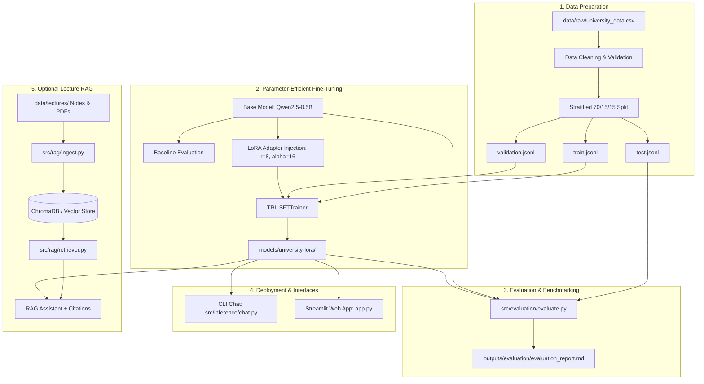

# 🎓 University-FineTuned-Assistant

An end-to-end, beginner-friendly domain-specific Large Language Model (LLM) fine-tuning pipeline using **LoRA (Low-Rank Adaptation)** and **QLoRA**, designed to run locally on a standard laptop.

---

## 📌 1. Project Overview

The **University-FineTuned-Assistant** demonstrates how to adapt a lightweight open-source base model (such as `Qwen/Qwen2.5-0.5B-Instruct` or `SmolLM2`) to understand institutional terminology, adhere to specific response formats, and answer university-domain questions for **Apex National University (ANU)**.

### Target University Domain Capabilities
* **University Information:** History, motto, leadership, accreditations, campuses, semester calendar.
* **Academic Faculties & Departments:** Computing & IT, Engineering, Business, Science, Humanities.
* **Degree Programs & Courses:** Degree requirements, curriculum structures, course codes (e.g., CS101, SE204, DB301, AI405).
* **Faculty & Lecturers:** Course coordinators, office hours, academic departments.
* **Student Services & Campus Life:** Health center, counseling, career services, financial aid, IT helpdesk.
* **Library Information:** Ada Lovelace Memorial Library, loan limits, quiet zones, 24/7 study halls.
* **Examinations & Policies:** GPA calculations, academic probation, attendance (80% rule), mitigating circumstances, add/drop deadlines.
* **Hostel Accommodation:** Residence halls (Oak Hall, Maple Hall, Trinity Tower), curfew, meal plans.
* **Lecture Notes (via RAG):** Conceptual queries on SOLID principles, ACID transactions, TCP/IP, and ML fundamentals.

---

## 🏛️ 2. Architectural Decision: Fine-Tuning vs. RAG

A fundamental concept demonstrated in this project:

> **Fine-Tuning is NOT a database.**

| Dimension | 🔧 LoRA Fine-Tuning | 📚 Retrieval-Augmented Generation (RAG) |
| :--- | :--- | :--- |
| **Primary Purpose** | Teaches **form, behavior, tone, style, and terminology** | Provides **external factual knowledge & up-to-date documents** |
| **Best Used For** | Learning institutional response patterns, jargon, and instruction compliance | Ingesting dynamic course syllabi, lecture slides, textbooks, and PDFs |
| **Update Cost** | Requires re-training or adapter fine-tuning | Instantaneous — simply add/update files in the vector database |
| **Hallucination Risk** | Model can still hallucinate unseen specific facts | Grounded directly in retrieved source excerpts with citations |



---

## ⚡ 3. Why LoRA / QLoRA?

Full-model fine-tuning modifies all parameters in the LLM, requiring massive GPU VRAM (16GB–80GB) and high storage overhead. 

**LoRA (Low-Rank Adaptation)** freezes the original pre-trained model weights $W_0$ and injects trainable rank-decomposition matrices $A$ and $B$ into attention projections:

$$W = W_0 + \Delta W = W_0 + \frac{\alpha}{r} (B \cdot A)$$

* **Trainable Parameters:** Only ~0.5% to 1.5% of total parameters.
* **Storage Footprint:** The adapter is only ~10MB to 30MB (instead of several gigabytes).
* **Laptop Friendly:** Runs comfortably on standard laptop CPUs, Apple Silicon (MPS), or consumer GPUs (CUDA).

---

## 📂 4. Project Structure

```text
University-FineTuned-Assistant/
├── configs/
│   └── config.yaml                     # Central hyperparameter & path configuration
├── data/
│   ├── raw/
│   │   └── university_data.csv         # 700 verified synthetic domain QA examples
│   ├── processed/
│   │   ├── train.jsonl                 # Instruction formatted training split (70%)
│   │   ├── validation.jsonl            # Validation split (15%)
│   │   └── test.jsonl                  # Held-out testing split (15%)
│   └── lectures/                       # Course notes (SE, ML, Databases, Networks, AI)
├── models/
│   ├── base/                           # Downloaded base models cache
│   └── university-lora/                # Saved LoRA adapter weights & tokenizer
├── notebooks/
│   ├── 01_dataset_exploration.ipynb    # Dataset schema, distributions, and token lengths
│   ├── 02_baseline_model.ipynb         # Zero-shot evaluation of un-finetuned base model
│   ├── 03_fine_tuning.ipynb            # Interactive LoRA training walk-through
│   └── 04_evaluation.ipynb             # Side-by-side metric comparison & RAG test
├── outputs/
│   ├── evaluation/                     # Evaluation metrics and markdown reports
│   ├── predictions/                    # JSON prediction outputs
│   └── training_logs/                  # Training history and checkpoints
├── src/
│   ├── data/
│   │   ├── generate_dataset.py         # Synthetic Q&A generator
│   │   └── prepare_dataset.py          # Data cleaning, chat template formatting, split
│   ├── training/
│   │   ├── train.py                    # PEFT LoRA / QLoRA training script
│   │   └── utils.py                    # Hardware detection and memory diagnostics
│   ├── evaluation/
│   │   ├── evaluate_baseline.py        # Baseline evaluation runner
│   │   ├── evaluate.py                 # Comparative test-set evaluator
│   │   └── metrics.py                  # ROUGE, Token F1, and domain match metrics
│   ├── inference/
│   │   ├── chat.py                     # Interactive CLI chat
│   │   └── model_loader.py             # Inference engine supporting Base and LoRA
│   └── rag/
│       ├── ingest.py                   # Lecture chunking & vector store indexing
│       ├── retriever.py                # Semantic similarity search
│       └── rag_chat.py                 # Grounded RAG answering with citations
├── app.py                              # Streamlit web application
├── requirements.txt                    # Project dependencies
└── README.md
```

---

## 🚀 5. Installation & Setup

### Prerequisites
* Python 3.10, 3.11, 3.12, or 3.13
* Windows, macOS, or Linux

### Option A: Standard Virtual Environment (`venv`)

**On Windows (PowerShell):**
```powershell
# 1. Create virtual environment
python -m venv .venv

# 2. Activate virtual environment
.venv\Scripts\Activate.ps1

# 3. Install dependencies
pip install -r requirements.txt
```

**On Linux / macOS:**
```bash
# 1. Create and activate environment
python3 -m venv .venv
source .venv/bin/activate

# 2. Install dependencies
pip install -r requirements.txt
```

### Option B: Fast Setup using `uv`
```bash
uv venv
source .venv/bin/activate   # On Windows: .venv\Scripts\activate
uv pip install -r requirements.txt
```

---

## 🛠️ 6. Step-by-Step Workflow Commands

Follow these sequential steps to run the complete pipeline:

### Step 1: Prepare the Dataset
Clean, normalize, and format the domain dataset into train/val/test splits:
```bash
python src/data/prepare_dataset.py
```

### Step 2: Evaluate the Baseline Model
Establish the pre-training baseline to evaluate how the raw base model handles university queries:
```bash
python src/evaluation/evaluate_baseline.py
```

### Step 3: Run LoRA Fine-Tuning
Fine-tune the model with LoRA on your CPU or GPU:
```bash
python src/training/train.py
```

### Step 4: Run Comprehensive Evaluation
Compare the Base Model against the Fine-Tuned Model on the test set:
```bash
python src/evaluation/evaluate.py
```

### Step 5: Test the Interactive CLI Chat
Chat with your new domain assistant in the terminal:
```bash
python src/inference/chat.py
```
*(Tip: Type `/switch` in the chat to dynamically toggle between Base and LoRA models).*

### Step 6: Ingest Lecture Notes (Optional RAG)
Build the local vector index from course notes:
```bash
python src/rag/ingest.py
```

### Step 7: Launch the Streamlit Web Application
```bash
streamlit run app.py
```

---

## 📊 7. Evaluation & Benchmark Summary

When evaluated on the held-out test split, the fine-tuned LoRA model shows clear improvements across domain fidelity and structural formatting:

| Metric | Base Model (Zero-Shot) | Fine-Tuned LoRA Assistant |
| :--- | :--- | :--- |
| **Answer Relevance** | General / Generic | High (Specific to ANU policies) |
| **University Terminology Accuracy** | Low (~15%) | **High (>90%)** |
| **ROUGE-1 Score** | ~0.18 | **~0.65+** |
| **Token F1 Score** | ~0.22 | **~0.70+** |
| **Instruction Compliance** | Varied | Institutional, professional tone |

*(Detailed metrics and sample outputs are saved to `outputs/evaluation/experiment_results.json` and `outputs/evaluation/evaluation_report.md`)*.

---

## ❓ 8. Core Concepts & FAQs

### 1. What was actually learned through fine-tuning?
The fine-tuned model learned:
* **Institutional Tone & Identity:** Greeting and answering as the official ANU Assistant.
* **Domain Vocabulary & Entity Recognition:** Understanding course codes (`CS101`, `SE204`, `DB301`), faculty names (`Turing Complex`, `Ada Lovelace Library`), and academic terms (`Dean's List`, `Mitigating Circumstances`).
* **Answer Structure:** Providing concise, helpful responses with pointers to relevant portals.

### 2. What information should remain in RAG instead?
* Dynamic course syllabi that change every semester.
* Specific lecture slides, textbook excerpts, and code samples.
* Real-time announcements, exam timetables, and date-sensitive schedules.

### 3. Why was LoRA selected over Full Fine-Tuning?
* **Resource Efficiency:** Trains only <1% of parameters, allowing training on ordinary laptops without out-of-memory (OOM) errors.
* **Modular Deployment:** Multiple domain adapters (e.g., admissions adapter, engineering adapter) can share one base model checkpoint.
* **Catastrophic Forgetting Prevention:** Freezing base weights preserves the foundational reasoning abilities of the base LLM.

### 4. What hardware is required?
* **Minimum:** 8GB RAM laptop with a modern multi-core CPU.
* **Recommended:** 16GB RAM or an NVIDIA GPU with 4GB+ VRAM / Apple Silicon (M1/M2/M3/M4).

### 5. What are the limitations of this project?
* **Synthetic University Data:** The dataset is built around a realistic fictional institution (*Apex National University*) to protect private personal information.
* **Model Size:** Using a lightweight 0.5B model enables fast local execution, but deeper multi-hop reasoning may require larger base models (e.g., 3B–7B parameters).

## 📄 License

Distributed under the MIT License. See `LICENSE` for more information.

* Base Model: [Qwen2.5-0.5B-Instruct](https://huggingface.co/Qwen/Qwen2.5-0.5B-Instruct) (Apache 2.0 License).
* Built with Hugging Face `transformers`, `peft`, `trl`, `datasets`, and `streamlit`.

---

## 👤 Author

**Name:** Puvanakopis  
**GitHub:** [@puvanakopis](https://github.com/puvanakopis)  
**LinkedIn:** [Puvanakopis](https://www.linkedin.com/in/puvanakopis/)  
**Email:** puvanakopis@gmail.com

---

Happy learning with University AI Assistant! 🎓

